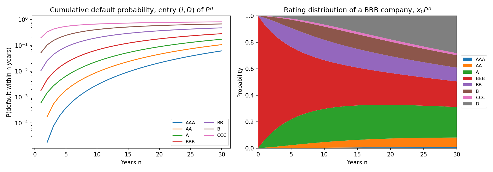
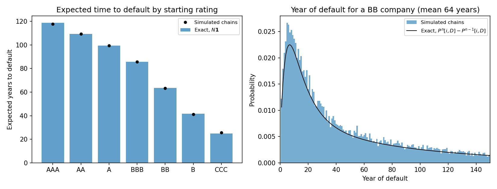
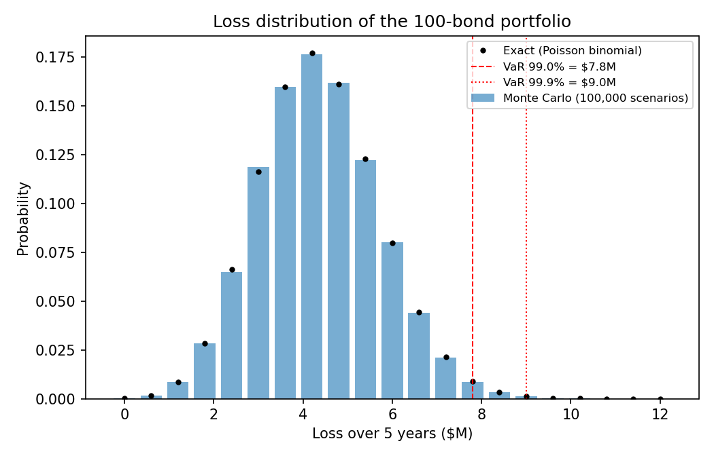
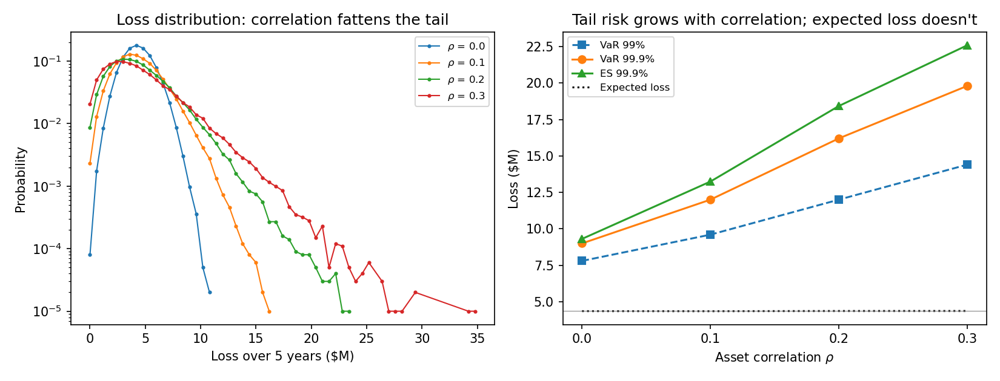
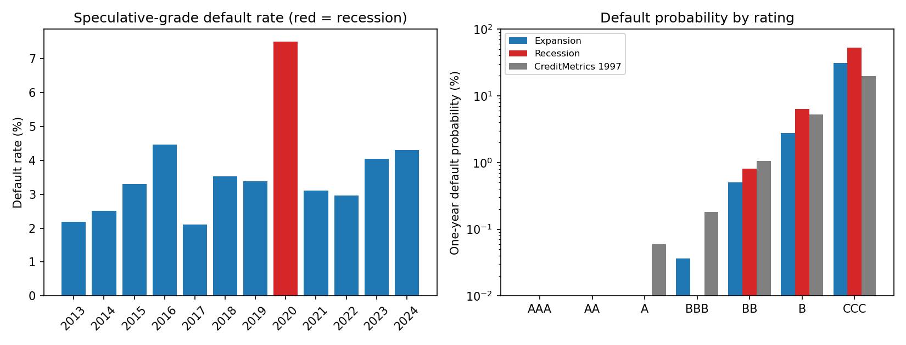
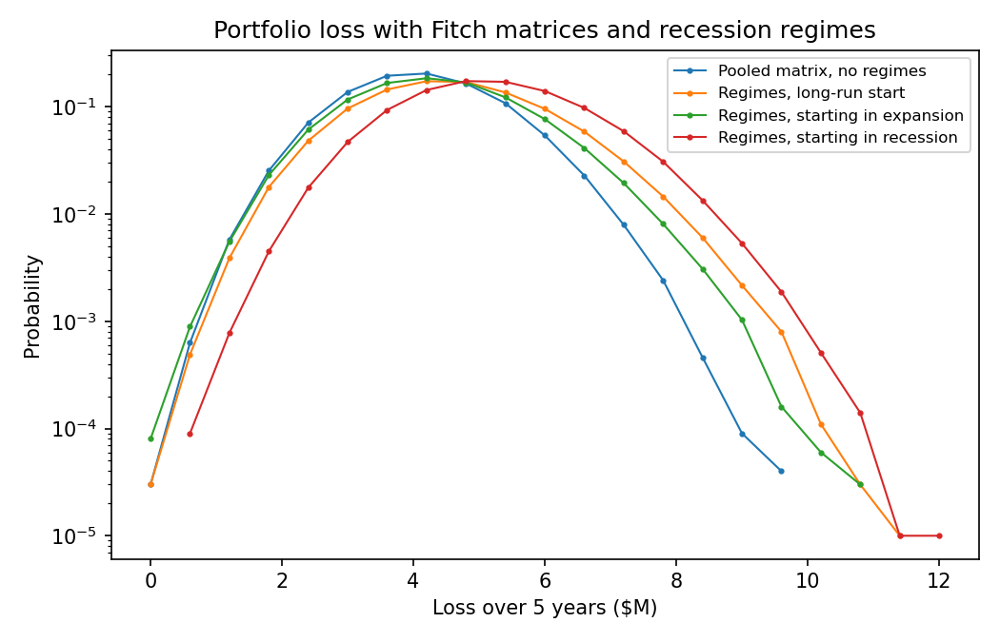

# Credit Rating Transitions as a Markov Chain

Models a company's credit rating as a Markov chain with states AAA, AA, A, BBB, BB, B, CCC and D (default). It uses the one-year transition matrix from the CreditMetrics Technical Document (J.P. Morgan, 1997), Table 6.2, stored in [data/](data/creditmetrics_1997_transition_matrix.csv). Any matrix with the same layout, such as a recent S&P table, can be dropped in.

`credit_rating_markov_chain.py` has four parts:

1. **Powers of P.** Checks that P is a Markov matrix and uses Pⁿ to get n-year default probabilities. Also finds the steady state and the rate of convergence to it from the eigenvalues.
2. **The fundamental matrix N = (I − Q)⁻¹.** Default is an absorbing state, so N gives the expected number of years at each rating before default and the expected time to default. Simulated chains check the result.
3. **Monte Carlo for a bond portfolio.** Simulates 100 bonds over 5 years and checks the simulated default rates against Pⁿ, and the simulated loss distribution, VaR and expected shortfall against their exact values.
4. **Correlated defaults.** Links the bonds through a one-factor Gaussian copula, so bad years hit every bond at once, and compares the loss tail and VaR with the independent case.

## Results

- **Convention:** credit risk uses the row convention x_{n+1} = x_n P, so each row sums to 1. Many linear algebra courses use columns, x_{n+1} = A x_n, which is the transpose.
- **Data quirk:** the published B row sums to 99.99% and the CCC row to 100.01% because of rounding. Each row is rescaled by its sum.
- **n-year default probabilities** are entry (i, D) of Pⁿ. Over 5 years: BBB 2.10%, BB 8.67%, B 24.4%, CCC 54.2%. AAA has a 0% one-year default probability but a positive one from year 2 on, since it can be downgraded first and then default. A single matrix entry can't show this; Pⁿ can.
- **Steady state:** the eigenvector of Pᵀ for λ = 1 puts all mass on D, so every company eventually defaults. The second eigenvalue λ₂ = 0.9882 sets how fast: the survival ratio S(n)/S(n−1) is 0.98 to 0.99 at n = 30 and exactly 0.9882 for every rating by n = 200.
- **Fundamental matrix** N = (I − Q)⁻¹, where Q is the 7 × 7 block of moves between non-default ratings. N[i, j] is the expected number of years spent at rating j before default, and the row sums are the expected years to default: AAA 119, BBB 86, BB 64, B 42, CCC 25. The distributions are very skewed (BBB has a median of 59 years and a standard deviation of 83). 20,000 simulated chains per rating agree, with |z| < 1.6 throughout.
- **Portfolio Monte Carlo:** 100 bonds (5 AAA, 10 AA, 25 A, 30 BBB, 15 BB, 10 B, 5 CCC), $1M face each, 40% recovery, 5 years, 100,000 scenarios in about 2.8 s. Ratings are sampled by inverse CDF on each row of P.
  - simulated default frequencies match Pⁿ for every rating at 1 and 5 years, within about 2 standard errors;
  - expected loss is **$4.356M** against an exact $4.357M (z = −0.2). 70% of it comes from the 15 B and CCC bonds;
  - VaR 99% = **$7.8M** and VaR 99.9% = **$9.0M**, both equal to the exact values. The exact loss distribution is a Poisson binomial, computed by convolving each bond's Bernoulli default distribution.
  - expected shortfall (ES) is the mean loss over the worst 1% or 0.1% of outcomes. Losses come in $0.6M steps, so ES counts only the part of the step at VaR that lies in the tail.
- **Correlated defaults (one-factor Gaussian copula):** each year, bond i's credit quality is X_i = √ρ Z + √(1 − ρ) ε_i. Z is the economy, shared by all bonds in a scenario, and ε_i is the bond's own news. Each X_i is still N(0, 1), so every bond still follows P exactly; only the dependence changes. ρ is the asset correlation, and the Basel II formula for corporate loans uses 0.12 to 0.24.

  | ρ | Expected loss | SD | VaR 99% | VaR 99.9% | ES 99.9% | P(loss > $10M) |
  |---|---|---|---|---|---|---|
  | 0 | 4.35 | 1.35 | 7.8 | 9.0 | 9.3 | 0.01% |
  | 0.1 | 4.35 | 1.97 | 9.6 | 12.0 | 13.2 | 1.0% |
  | 0.2 | 4.36 | 2.52 | 12.0 | 16.2 | 18.4 | 3.2% |
  | 0.3 | 4.37 | 3.03 | 14.4 | 19.8 | 22.6 | 5.5% |

  - **expected loss doesn't change** with ρ (exact $4.357M, all |z| < 1.4), because correlation doesn't change any single bond's chance of default;
  - **the tail does change:** at ρ = 0.2, VaR 99.9% rises from $9.0M to $16.2M (1.8×) and a loss over $10M goes from about 1 in 10,000 to about 1 in 30. Correlation also makes a loss-free 5 years more likely (0.9% against 0.01%), so the distribution spreads out both ways;
  - **check:** over one year, defaults given Z are independent, so the exact loss distribution is a Poisson binomial averaged over Z by Gauss-Hermite quadrature (it agrees with adaptive integration to about 10 decimal places). Every exact VaR falls inside the simulated VaR's 95% order-statistic CI. With 1M scenarios the simulated ES 99% is within 0.01 of exact. Over 5 years ratings also migrate and defaults depend on the whole path of Z, so there's no such formula, and Monte Carlo is the method.






## Real data and a recession regime

[`real_data_and_recessions.py`](real_data_and_recessions.py) replaces the 1997 table with matrices estimated from Fitch's corporate issuer default ratings. Fitch publishes this rating history under SEC Rule 17g-7(b), and [ratingshistory.info](https://ratingshistory.info) converts it to CSV. [`estimate_fitch_matrices.py`](estimate_fitch_matrices.py) turns the raw file into transition counts by year, saved in [data/fitch_transition_counts.csv](data/fitch_transition_counts.csv). The 29 MB raw file isn't in the repo.

**Estimation (cohort method, as rating agencies do it).** Each year, every issuer rated on January 1 is followed to the next January 1, and its move is counted. A default at any time in the year counts as a move to D. Fitch's RD (restricted default, for example a distressed debt exchange) also counts as default. An issuer whose rating is withdrawn leaves that year's count. The maximum-likelihood estimate of the matrix is P[i, j] = n_ij / n_i. Fitch's notches are pooled into the 7 grades, with CCC+ to C as CCC.

- **Data:** cohorts 2013 to 2024, 20,768 issuer-years, 308 defaults, 1,607 withdrawals left out. Ratings outstanding in June 2012 are reported from then on, and 2025 is incomplete.
- **Pooled one-year default rates:** BBB 0.03%, BB 0.53%, B 3.1%, CCC 33.6%. Compared with CreditMetrics 1997, investment grade is much safer and CCC is riskier, partly because Fitch's CCC pool includes CC and C. 5-year default probabilities from P⁵: BB 5.4%, B 23%, CCC 72%.
- **Thin rows:** only 7 AAA issuer-years (Fitch rates a handful of AAA companies), so the AAA row is a guess. The 95% Wilson interval for its default rate runs from 0% to 35%. In the recession year, rows with fewer than 30 issuer-years (AAA and AA) use the pooled row.
- **The economy is visible in the data.** The speculative-grade default rate was 2.1% to 4.5% in other years and 7.5% in 2020. The downgrade rate was 7.2% in 2020 against 2.5% to 6.0% in other years, and the upgrade rate was the lowest in the data (1.7%).
- **Recession against expansion one-year default rates:** BB 0.81% against 0.50%, B 6.4% against 2.8%, CCC 52% against 31%. Over 5 years, P⁵ gives B 43% against 21%. The 95% intervals for B and CCC don't overlap. BB's do, because only 371 BB issuer-years fall in 2020.
- **Caveat:** 2020 is the only recession in the data. It was short and came with heavy government support, so this one-year sample shouldn't be read as "the" recession matrix.

**Regime switching.** The economy gets its own two-state Markov chain, estimated the same way as the rating matrices. The data are year-to-year moves between expansion and recession in the NBER recession calendar for 1946 to 2024. A year counts as a recession year if any month of it was in recession, the same rule that makes 2020 the recession cohort.

| | → Expansion | → Recession |
|---|---|---|
| Expansion | 0.80 (44) | 0.20 (11) |
| Recession | 0.48 (11) | 0.52 (12) |

The steady state is 70.5% expansion and 29.5% recession. The second eigenvalue is 0.32, so the starting regime is mostly forgotten after 2 or 3 years. Mean lengths are 5.0 years for an expansion and 2.1 years for a recession. Each simulated year draws the regime first, then moves every bond with that regime's matrix. Bonds are independent within a year, but a recession raises all of them together.

| 5-year loss ($M), 100 bonds | Expected loss | SD | VaR 99% | VaR 99.9% | ES 99.9% | P(loss > $5M) |
|---|---|---|---|---|---|---|
| Fitch pooled matrix, no regimes | 4.13 | 1.16 | 7.2 | 7.8 | 8.3 | 20% |
| Regimes, long-run start | 4.62 | 1.37 | 7.8 | 9.0 | 9.7 | 34% |
| Regimes, starting in expansion | 4.37 | 1.30 | 7.8 | 9.0 | 9.2 | 27% |
| Regimes, starting in recession | 5.22 | 1.36 | 8.4 | 9.6 | 10.1 | 52% |

- **Regimes raise expected loss,** unlike the copula, because recessions are 29.5% of years in the NBER history against 8% (1 in 12) of the Fitch years. Starting in a recession adds about $0.9M of expected loss compared with starting in an expansion, and P(loss > $5M) roughly doubles.
- **The tail grows less than with the copula.** VaR 99.9% goes from $7.8M to $9.0M to $9.6M, against $16.2M for the copula at ρ = 0.2. Two regimes capture only the economy-wide part of default clustering. Within a year the bonds are still independent, so shocks to one sector (energy in 2016, Chinese property in 2022–23) are missing.
- **Check:** given the regime path, bonds are independent, and over 5 years there are only 2⁵ = 32 paths. Along each path the 5-year matrix is the product P_{r1} ⋯ P_{r5}, so the exact loss distribution is a probability-weighted mixture of 32 Poisson binomials. Every exact VaR is inside the simulated 95% CI. With 100,000 scenarios the simulated ES 99.9% runs up to 1.5% low, because it averages only the worst 100 outcomes. A 1M-scenario run matches (9.816 against 9.822).




## Run

```bash
pip install numpy pandas scipy matplotlib
python credit_rating_markov_chain.py
python real_data_and_recessions.py
```

Each script prints its tables and saves its plots to `plots/`. Numbers above are from seed 42. To rebuild the Fitch counts from the raw file, download it into `data/raw/` and run the estimator:

```bash
mkdir -p data/raw
curl -o data/raw/fitch_corporate_20261001.csv "https://ratingshistory.info/api/public/20261001%20Fitch%20Ratings%20Corporate.csv"
python estimate_fitch_matrices.py
```
